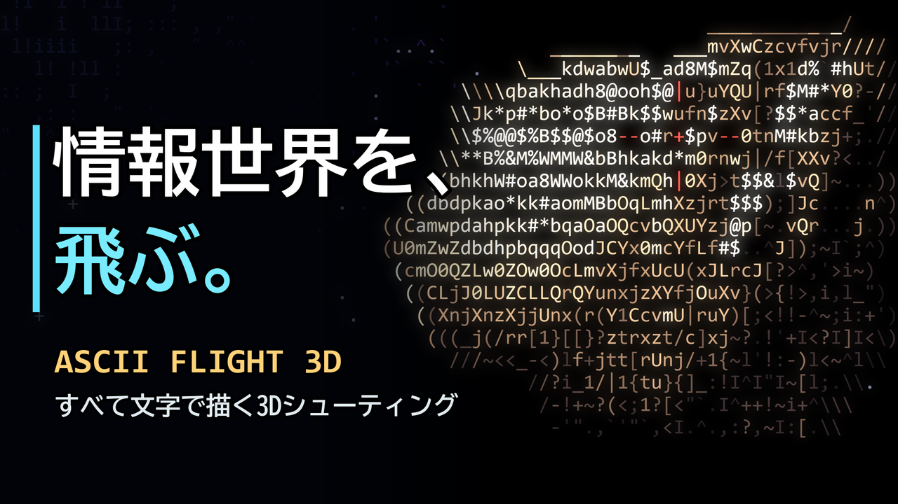

# ASCII FLIGHT 3D

**情報世界を、飛ぶ。**

ターミナルの中で遊ぶ、3Dフライトシューティングです。迫ってくる隕石も、巨大な母艦も、爆発の火花も、画面に映るものはすべてASCII文字で描かれています。

<!-- 紹介動画をYouTubeに上げたら、次の行の先頭と末尾の記号を外し、URLを差し替えてください。 -->
<!-- ▶ [紹介動画を見る](ここにYouTubeのURL) -->

## ダウンロード

**[最新版のダウンロードページを開く](../../releases/latest)**

ページの「Assets」にある `ASCII_FLIGHT_3D_Windows_exe.zip` をダウンロードしてください。Pythonなどのインストールは必要ありません。

## 遊び方

1. ダウンロードしたZIPをすべて展開します。
2. `ASCII_FLIGHT_3D.exe` をダブルクリックします。
3. Enterキーで出発します。

### 操作

| キー | 動作 |
|---|---|
| 矢印キー / WASD | 移動 |
| スペース | レーザー（撃ち続けるとオーバーヒートします） |
| P | 一時停止 |
| M | 音のオン/オフ |
| Enter | 開始 |
| Q / Esc | 終了 |

ウィンドウを最大化し、Ctrl + マイナスで文字を小さくすると、より細かく表示されます。

### ゲームの流れ

- **よける**: 迫る隕石をかわします。
- **撃つ**: レーザーで隕石を砕きます。押しっぱなしにするとオーバーヒートして、しばらく撃てなくなります。
- **守る**: 緑の球を取ると、シールドが回復します。
- **ボス戦**: 4基のポッドを破壊してから、中央のコアを撃ち抜きます。ボス戦の間は、レーザーを撃ち放題です。

ハイスコアは、exeと同じフォルダの `game_highscores.json` に保存されます。

## 起動時の警告について

このexeには署名がないため、Windowsの「PCが保護されました」という画面が出ることがあります。配布元を信頼できる場合は、「詳細情報」→「実行」で起動できます。

## 動作環境

Windows のみ（Windows 11 で動作確認）

## 利用条件

Copyright (c) 2026 ASCII FLIGHT 3D の作者. All rights reserved.

このゲームを遊ぶことは自由です。 プレイ動画の投稿や、実況・配信も自由に行えます。作者の許可なく、改変、再配布、転載をすることは禁止します。

---

## English

**Fly through a world of information.** A 3D space shooter played in your terminal, where asteroids, a giant mothership and explosions are all drawn with ASCII characters.

- **Download:** open the [latest release](../../releases/latest) and get `ASCII_FLIGHT_3D_Windows_exe.zip` from "Assets". Python is not required.
- **Run:** extract the ZIP, then double-click `ASCII_FLIGHT_3D.exe`.
- **Controls:** Arrows/WASD move, SPACE fires (overheats if held), P pauses, M toggles sound, ENTER starts, Q/ESC quits.
- **Windows warning:** the .exe is unsigned, so Windows may show a warning. If you trust the source, choose "More info" and then "Run anyway".
- **Requirements:** Windows only (tested on Windows 11).

Copyright (c) 2026 the author of ASCII FLIGHT 3D. All rights reserved. You may play this game. Modifying or redistributing it without permission is prohibited.
